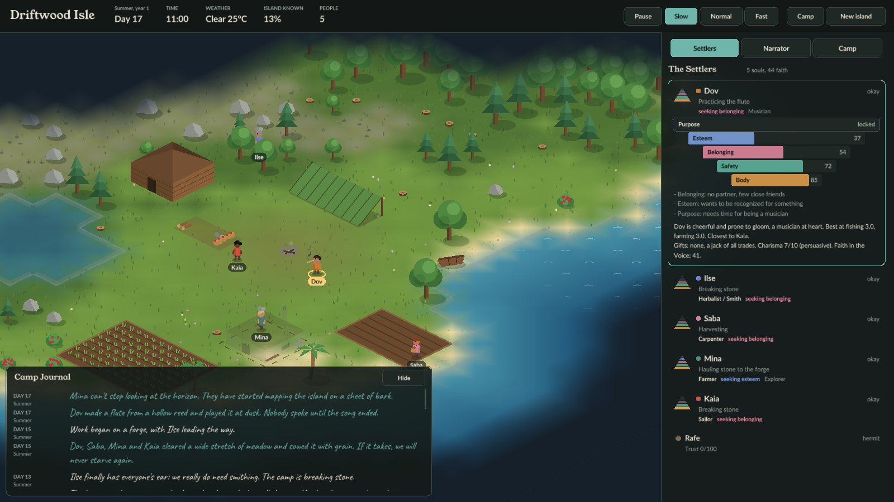
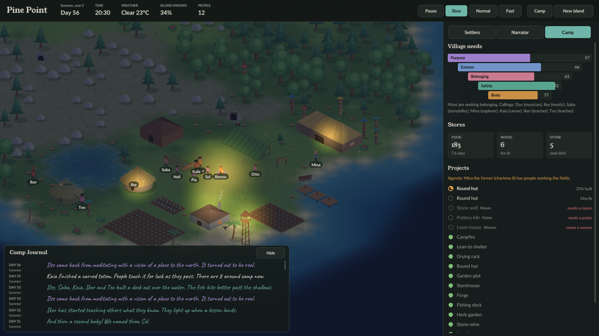
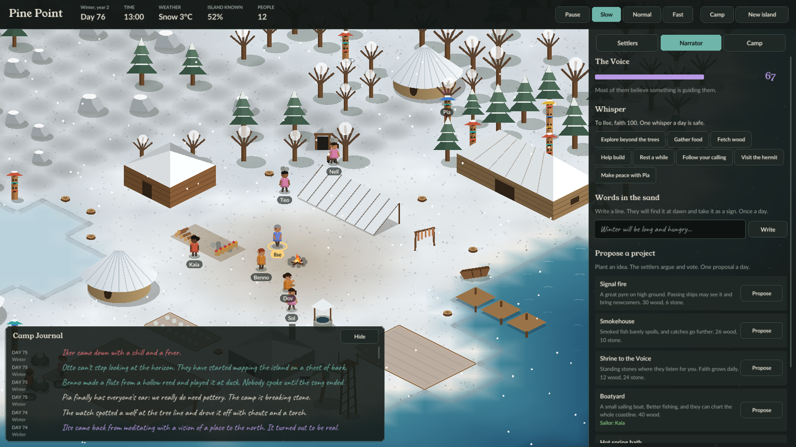

# Driftwood

An isometric island colony sim. Five castaways wash ashore with a hatchet, a knife and a sack of seeds. They build a village, form friendships, fall in love, find their callings and fight through winters. You don't control them. You are the **narrator**: everyone on the island knows you are there and takes it in their stride, like the weather. You nudge their story with lines, words in the sand and choices of fate.





## What makes it tick

- **Maslow's hierarchy of needs.** Every settler has five levels: body, safety, belonging, esteem and purpose. Higher levels only matter once the lower ones are met. Fulfilled settlers discover a **calling** (carver, musician, storyteller, explorer, inventor, healer, teacher, philosopher) that changes the village.
- **Gifted specialists.** Everyone can chop wood and lash a shelter together. Ambitious projects need a gifted person: no farmer, no fields; no smith, no forge; no mason, no well. Specialists get better and quicker with practice, up to level 10. Some settlers are tireless, and night owls sleep through the middle of the day and work the night.
- **Charisma.** A magnetic smith will talk the camp into breaking stone even when it isn't what they need most. A quiet one waits until the need is real.
- **A living island.** Fog of war to explore, seasons, storms, wolves in winter, a hermit in the forest, ruins, a cave and an old wreck to find. Shipwrecks, signal fires and births grow the village.
- **The narrator's tools.** Narrate what one settler does next, from two or three lines that fit them. Rapport, the meter at the top, is what you spend: each line has a price, cheap when it is what they want anyway and dearer the less that settler buys into the narrator. Rapport comes in every day from how much they buy in, and good spots for your buildings and seasons with nobody lost add more. Settlers ask you things too, and an honest, teasing or misleading answer each has its price. Push the same person too often and they turn contrary: stubborn people sooner, easygoing ones later. The Narrator's Ledger flags what is going wrong (nobody on wood, food running out, no builder, sickness and no herbalist), ranks who could fix it by price, and offers four sizes of nudge: ask for today, ask for the season, appoint to a role, or appeal to everyone. Households rise from castaways to notables as their homes grow from hut to cottage, house and manor, each step asking more of the village (food in store and of several kinds, goods such as pots, blankets, furniture, fine cloth and spices that gifted workers make and homes use up, a well and other services within walking reach, pleasant surroundings), and fall back when it lapses. The higher a household rises, the less it hauls stone and wood: notables lead the building, trade with passing ships, commission monuments and keep the artisans going, and one seen at common work lifts the others but loses standing if it goes on. The gap between the top and the bottom breeds resentment. You draw up the village: settlers build their own homes, and everything else is a blueprint you place from the Build tab, unlocked as the village clears the levels of need, built well or roughly by whoever takes it on. Paths wear in where people walk. Clear groves, plant orchards, throw footbridges over water, set out flower beds, lanterns, benches and banners, and name the buildings. Households petition the narrator for buildings, better homes, feasts and luxuries, each by a day. Every year the narrator sees a trial coming (a hard winter, sickness, drought, storms, then two at once) and the village gets ready, or pays for not being. A charismatic settler may set themselves up as the rival, winning over the resentful; fall behind them for a season and they plan the village until it turns back to you. Each year ends with a review, and the run ends well (Haven, Homeward on a ship the notables paid for, or Awakening in the ruins) or badly (Overruled, Lost, Divided), with the whole story read back. Write words in the sand that they find at dawn. Propose projects and watch them vote. Choose one of three fate cards each season. Their rapport with you rises and falls with how it all turns out, and a story circle by the fire raises it.

## Controls

| Action | Input |
|---|---|
| Pan | Hold left mouse button and drag, or arrow keys / WASD |
| Zoom | Mouse wheel, or `+` / `-` |
| Select a settler | Click them on the map or in the Settlers tab; a dashed line shows what they are working on |
| Inspect anything | Click a building, tree, rock or place for its card; Esc or a click on open ground closes it |
| Show all work | `C` draws every settler's line to their work |
| Pause / speeds | `Space`, `1` `2` `3`, or the buttons at the top |
| Toggle journal | `J` |
| Menu (save, load, quit to title) | `Esc` |
| Quick save / quick load | `F5` / `F9` |
| Place a specialist building | Click a spot when the game asks; `Esc` lets the settlers choose |

## Building

You need CMake 3.20+ and a C++20 compiler. [raylib](https://www.raylib.com) is downloaded automatically.

```sh
cmake -S . -B build -DCMAKE_BUILD_TYPE=Release
cmake --build build --config Release
./build/driftwood            # Windows: build\Release\driftwood.exe
```

On Linux, install the windowing headers first:

```sh
sudo apt install libxrandr-dev libxinerama-dev libxcursor-dev libxi-dev libgl1-mesa-dev libasound2-dev
```

Ready-to-run builds for Windows, macOS and Linux are produced by GitHub Actions on every push (see the **Actions** tab, then the build's artifacts).

### Tests

The simulation runs headless, so it has its own test suite, and the renderer's geometry (projection, picking) has a second one that never opens a window:

```sh
ctest --test-dir build -C Release --output-on-failure
```

### Screenshots without a window session

The game can fast-forward and save a screenshot, which is handy for docs and for checking visuals in CI:

```sh
./build/driftwood --screenshot village.png --days 40 --hour 20.5 --zoom 1.2 --select 1 --tab 1
```

## Architecture

```
src/
  sim/      the simulation: pure C++20, no graphics, deterministic per seed
  engine/   our engine layer on raylib: drawing primitives, UI toolkit, lighting
  game/     isometric world view, procedural art, HUD, main loop
tests/      headless simulation tests
assets/     fonts (and, later, sprites, sounds, shaders)
```

- **`sim`** knows nothing about rendering. `Sim::step(minutes)` advances time; front ends read state and call narrator actions (`whisper`, `writeSand`, `propose`, `applyFate`). The same seed always produces the same history.
- **`engine`** is deliberately small: batched 2D shapes with per-vertex color (`Draw`), an immediate-mode UI (`Ui`), and a screen-space light pass (`Lighting`).
- **`game`** turns the simulation into pictures. All art lives in `game/Art.cpp` as procedural drawing, one function per object, so each can be replaced by sprite art independently.

## Roadmap toward nicer graphics

The art is procedural for now, which keeps iteration fast. The path forward, roughly in order:

1. Sprite atlases and frame animation for settlers (walk cycles, tools, emotes), replacing `art::person`.
2. Hand-painted building and tree sprites, swapped in object by object.
3. A shader lighting pipeline: normal-mapped sprites, colored point lights, soft shadows.
4. Post-processing: color grading per season and time of day, bloom on fires and lamps.
5. Animated water (flow maps, shoreline foam), wind in grass and trees.
6. Sound: ambience per season, footsteps, the musician's flute.

Also planned on the gameplay side: saving and loading, more events, trade with passing ships.

## License

Code: MIT. Fonts: SIL Open Font License (see `assets/fonts/OFL.txt`).
